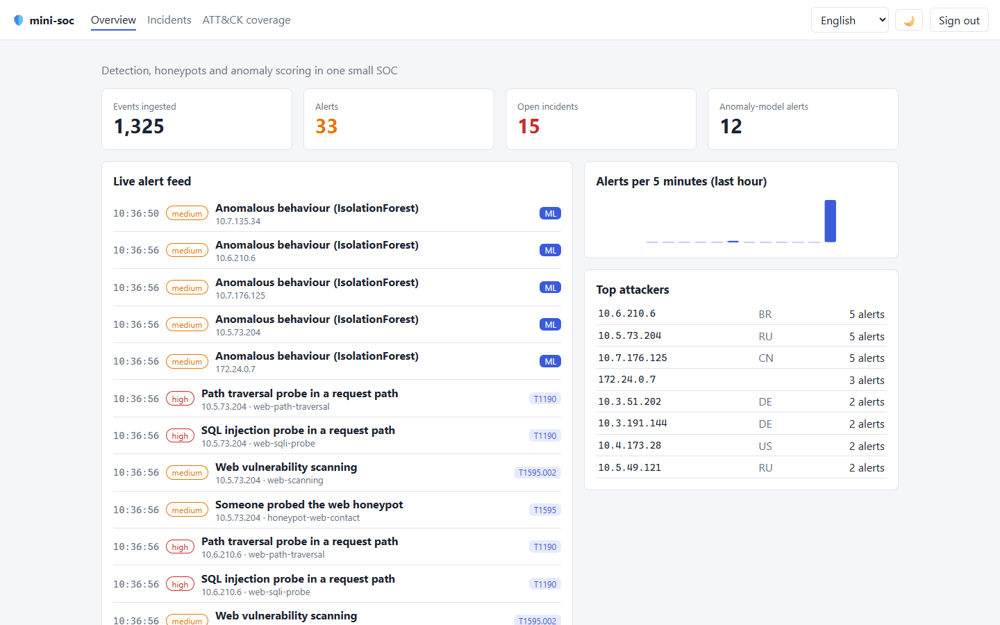
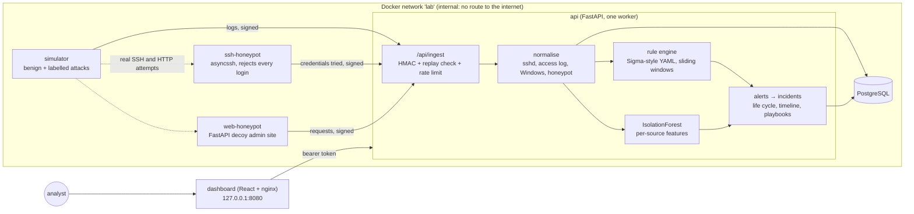
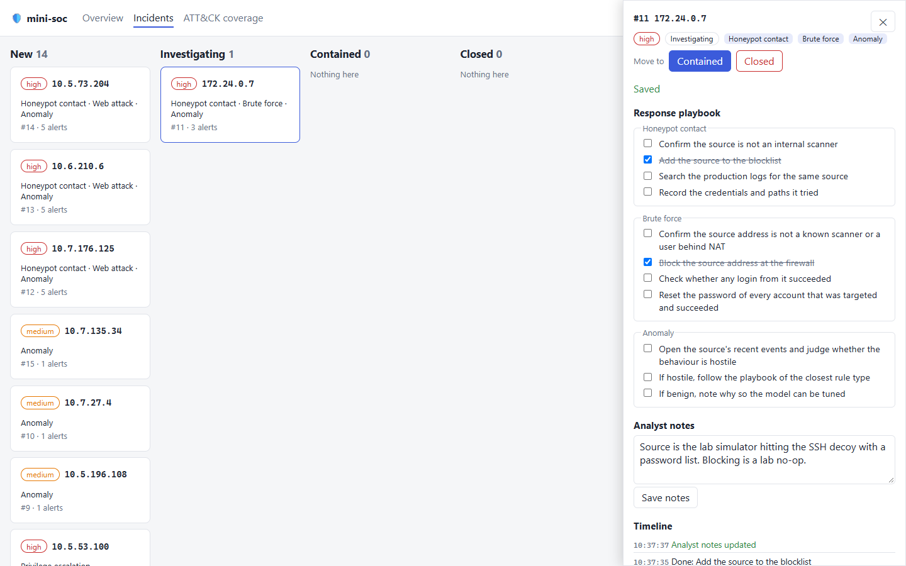
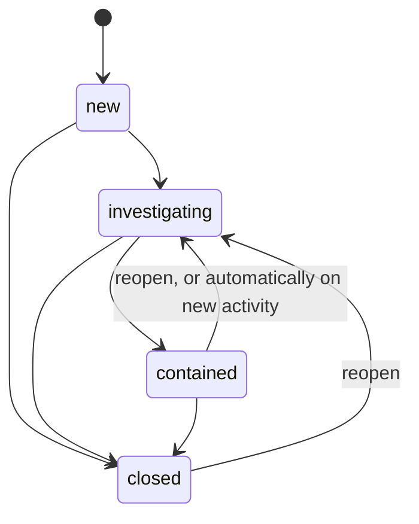
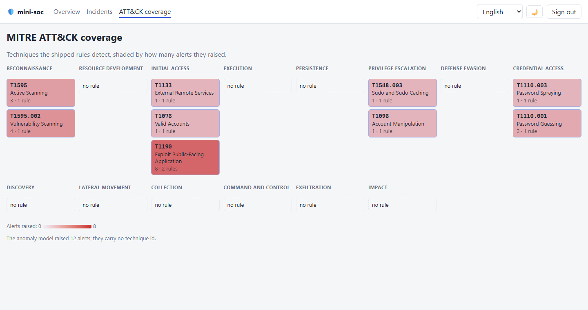

# mini-soc

[](https://github.com/KimThanhTran/mini-soc/actions/workflows/ci.yml)


A small security operations centre you can run with one command. Logs from SSH, web servers and Windows go in; Sigma-style
rules, two honeypots and an anomaly model raise alerts; alerts group into incidents that an analyst works through a status
life cycle with a response checklist. Everything runs inside a Docker network that has no route to the internet.



It exists to show the three parts of SOC work, and how they feed each other:

| SOC duty | Where it lives here |
|---|---|
| **Operate security systems** | Ingestion API with signed sensors, a rule engine with versioned Sigma-style rules, two honeypot sensors, hardened containers, CI that boots the whole stack |
| **Monitor, analyse and handle incidents** | Alerts mapped to MITRE ATT&CK, incidents with a status life cycle, timeline, analyst notes and a response playbook per incident type, dashboard with live feed and coverage matrix |
| **Join larger technology projects** | Four services plus a database wired with Compose, a documented threat model, an honest evaluation of the ML part, tests for every rule |

**Contents:** [Run it](#run-it) · [Two-minute tour](#two-minute-tour) · [Architecture](#architecture) · [Detection rules](#detection-rules) ·
[Incident handling](#incident-handling) · [Honeypots](#honeypots) · [Anomaly detection](#anomaly-detection-isolationforest) ·
[API](#api-at-a-glance) · [Threat model](#threat-model) · [Limitations](#limitations) · [Roadmap](#roadmap) ·
[Tiếng Việt](#tóm-tắt-tiếng-việt)

| | |
|---|---|
| **Backend** | Python 3.13, FastAPI, SQLAlchemy 2, PostgreSQL 16, scikit-learn, PyYAML |
| **Sensors** | asyncssh (decoy SSH), FastAPI (decoy web site), signed batch shipper |
| **Dashboard** | React 18 + Vite, nginx; light and dark theme, English and Vietnamese |
| **Delivery** | Docker Compose (internal network, hardened containers), GitHub Actions (lint, tests, full-stack smoke test) |
| **Quality** | 124 automated tests: every rule has a positive and a negative case; 92 % line coverage on the backend |

## Run it

You need Docker (Compose v2). Nothing else.

```bash
docker compose up --build
```

Open <http://127.0.0.1:8080> and sign in with the demo token `demo-analyst-token-change-me`. The `simulator` container runs
once after the API is healthy: it replays an hour of benign traffic, sends ten labelled attack scenarios, then attacks the two
honeypots over the Compose network. About a minute later the dashboard is full. To play it again, with another seed:

```bash
docker compose run --rm simulator python simulate.py --seed 7
```

To use your own secrets, copy `.env.example` to `.env` and fill it in. Without one, Compose uses the labelled demo values and
the API logs a warning. The dashboard is the only published port, and only on `127.0.0.1`; the API's Swagger page is at
<http://127.0.0.1:8080/api/docs>. `docker compose down -v` removes everything, including the database volume.

**Run the tests without Docker** (Python 3.13 and Node 24):

```bash
python -m venv .venv && source .venv/bin/activate        # Windows: .venv\Scripts\activate
pip install -r backend/requirements-dev.txt -r sensors/requirements.txt
(cd backend && python -m pytest --cov=app)               # 104 tests, 92 % line coverage
python -m pytest sensors/tests                           # 16 tests: honeypots, shipper, simulator safety guard
ruff check .                                             # lint
(cd frontend && npm ci && npm test && npm run build)     # 4 tests, production build
(cd backend && python -m app.evaluate --seeds 10)        # precision and recall of rules vs model
```

## Two-minute tour

Once the dashboard is full:

1. **Overview.** The live feed mixes rule alerts (with ATT&CK chips such as `T1190`) and `ML` alerts from the anomaly model.
   Top attackers shows the addresses behind them, with a country from the demo geolocation table.
2. **Incidents.** Open the incident for `172.24.0.7`: that is the simulator's real SSH login attempts against the decoy, so a
   *Honeypot contact*, a *Brute force* and an *Anomaly* alert from three different detectors sit in one incident, each type with
   its own playbook. Move it to *Investigating*, tick a step, write a note, and watch the timeline record all three.
3. **ATT&CK coverage.** Technique cells darken with the alerts their rules raised; empty tactics are visible gaps, not hidden ones.
4. **See what the rules miss.** Three simulated attacks (slow brute force, slow password spray, slow web scan) are built to stay
   under every rule threshold. They show up only as `ML` alerts. That is the argument for running both detectors.
5. **Try the safety rails.** `curl http://127.0.0.1:8080/api/stats` answers `401`; the simulator refuses to run against a
   public address: `docker compose run --rm simulator python simulate.py --api http://8.8.8.8`.

## Architecture



The pieces, and why they are shaped this way:

- **One normalised event.** sshd lines, combined-format access logs, Windows event records (4624, 4625, 4732) and honeypot
  records all become `{ts, source, src_ip, user, action, outcome, http_*, geo, extra}`. Rules are written against that
  shape, so a brute-force rule covers SSH, Windows and the honeypots without caring where the failures came from.
  Records that cannot be understood are reported back to the sensor, never stored as guesses.
- **The engine is in memory and event-timed.** Windows slide on the events' own timestamps, so a replay or a test gives the
  same answer every time. The price is that its state lives in one process: run one worker (the Dockerfile does).
- **Alerts group into incidents by attacker.** One open incident per source address (or account when there is none); alerts
  from the same entity within 30 minutes join it, and each new incident type adds its playbook steps.
- **The honeypots are decoys on the same bus.** A contact is an event like any other, so a honeypot hit and a brute-force burst
  from the same address land in one incident.

## Detection rules

Rules are YAML files in [`backend/app/rules/`](backend/app/rules). A test fails if a rule has no ATT&CK technique and tactic,
or if it has no positive and negative test.

| Rule | ATT&CK | Level | Fires when |
|---|---|---|---|
| `ssh-brute-force` | T1110.001 Password Guessing | high | 10+ failed logins from one address within 60 s (SSH, Windows, honeypots) |
| `password-spraying` | T1110.003 Password Spraying | high | 8+ distinct usernames failed from one address within 5 min |
| `impossible-travel` | T1078 Valid Accounts | high | one account logs in from two countries >500 km apart faster than 900 km/h |
| `web-scanning` | T1595.002 Vulnerability Scanning | medium | 15+ distinct paths answered 404 for one address within 60 s |
| `web-sqli-probe` | T1190 Exploit Public-Facing Application | high | request path carries `UNION SELECT`, `OR 1=1`, `SLEEP()`, `information_schema` |
| `web-path-traversal` | T1190 Exploit Public-Facing Application | high | request path climbs out of the web root or names `/etc/passwd`; decoded twice, so `%252e%252e` does not hide it |
| `priv-esc-after-login` | T1548.003 Sudo, T1098 Account Manipulation | high | same account spawns a root shell or is added to Administrators within 10 min of a login |
| `honeypot-ssh-contact` | T1133 External Remote Services | medium | any login attempt on the decoy SSH server |
| `honeypot-web-contact` | T1595 Active Scanning | medium | any request to the decoy admin site |

A rule looks like this (the real file also carries a description and the incident type):

```yaml
id: password-spraying
level: high
tags: [attack.credential_access, attack.t1110.003]     # tactic and technique
detection:
  failed_login: {action: auth, outcome: failure}
  condition: failed_login                              # and / or / not / parentheses over selection names
correlation:
  type: value_count        # event_count | value_count | temporal | impossible_travel
  value_field: user
  group_by: [src_ip]
  timespan: 5m
  threshold: 8
```

Selections support `contains`, `startswith`, `endswith`, `re`, `gte`/`gt`/`lte`/`lt`; lists are OR, fields are AND, strings
compare case-insensitively. After an alert the same rule stays quiet for the same key for one timespan (or `cooldown`), so one
burst is one alert.

## Incident handling





Every change is written to the incident's timeline (alerts, status moves, playbook ticks, note edits). The server refuses
illegal moves with `409`. Playbooks exist for brute force, spraying, impossible travel, web attacks, privilege escalation,
honeypot contact and anomalies (for example "block the source address", "reset the password of every account that
succeeded", "isolate the host").

The ATT&CK view shades each technique by how many alerts its rules raised:



## Honeypots

Both are small Python services on the internal network, shipping every touch through the same signed API as any other sensor.

- **`ssh-honeypot`** speaks real SSH ([asyncssh](https://asyncssh.readthedocs.io)), presents an OpenSSH banner, asks for a
  password for every username, **always says no**, and reports the username and password tried. It never opens a session.
- **`web-honeypot`** is a FastAPI decoy "router admin" site. A few bait paths (`/admin`, `/wp-login.php`, `/phpmyadmin/`)
  return a login form, everything else 404s. Posted credentials are captured and refused. Pages are static text, so nothing
  the visitor sends is ever reflected.
- Containers run as non-root with a read-only file system, no capabilities, memory and process limits, and no route out.
  They are not published on the host. See [SECURITY.md](SECURITY.md).

## Anomaly detection (IsolationForest)

For every source address the model sees the last five minutes and four numbers: **failed logins per minute**,
**distinct usernames tried**, **requests per minute**, **share of HTTP errors**. It is an
[IsolationForest](https://scikit-learn.org/stable/modules/generated/sklearn.ensemble.IsolationForest.html) trained at API
start on six hours of generated benign traffic only (no attacks), and it scores each source that sent events, once per tick.
A window with fewer than five events is not scored. Alerts say which numbers drove them and carry no ATT&CK id, because a
statistical outlier is not a technique.

**How well does it work?** `python -m app.evaluate` generates a test set the model never saw and compares the detectors.
Unit of evaluation: a source address. An attacker is detected if any alert names it; a benign source is a false positive if
any alert names it. Ten seeds, each with 120 min of benign traffic and 8 instances of each of 10 scenarios (7 classic, 3 slow).
Full output in [docs/ml-evaluation.md](docs/ml-evaluation.md).

| Detector | Precision | Recall | False-positive benign sources per run |
|---|---|---|---|
| rules only | 1.00 | 0.67 | 0.0 |
| model only | 0.96 | 0.69 | 2.3 |
| rules + model | 0.97 | 0.97 | 2.3 |

| Scenario | Kind | Rules | Model | Both |
|---|---|---|---|---|
| ssh_bruteforce, password_spray, web_scan | classic | 1.00 | 1.00 | 1.00 |
| sqli_probe | classic | 1.00 | 0.88 | 1.00 |
| path_traversal | classic | 1.00 | 0.00 | 1.00 |
| priv_esc | classic | 0.97 | 0.00 | 0.97 |
| impossible_travel | classic | 0.71 | 0.00 | 0.71 |
| **slow_bruteforce** (4 failures/min) | slow | **0.00** | **1.00** | 1.00 |
| **slow_spray** (1 username/min) | slow | **0.00** | **1.00** | 1.00 |
| **slow_scan** (10 paths/min) | slow | **0.00** | **1.00** | 1.00 |

How to read this, honestly:

- **The slow attacks were built to sit under the rule thresholds**, so "the model catches what the rules miss" is true by
  construction. It shows that the two detectors are complementary, not that the model would find real attackers.
- **The data is synthetic and so is the baseline**, both written by me from the same generator. Real traffic is messier, so
  expect worse precision. Treat the numbers as a regression check, not a benchmark.
- The model never fires on `path_traversal`, `priv_esc` or `impossible_travel`: those are single events or two events, not a
  rate, so the four features cannot see them. That is why the rules exist.
- The 0.71 for `impossible_travel` is a test-set artefact: every one of the 23 misses (out of 80) has another instance on
  the same victim account within 40 minutes, and the rule tracks one last login per account and then cools down for 30 minutes.
- Over the ten runs the 23 false positives were the misconfigured service account (10), the link checker with its broken links
  (6) and ordinary users who mistyped a password several times (7). The threshold (`contamination=0.02`) is a
  precision/recall dial: at 0.005 the model had no false positives and caught only 20 % of the attackers.

## API at a glance

Interactive docs at `/api/docs`. Ingestion needs the sensor headers `X-Sensor-Id`, `X-Timestamp` and
`X-Signature = hex(HMAC-SHA256(secret, timestamp + "." + body))`; everything else needs `Authorization: Bearer <token>`.

| Method and path | Purpose |
|---|---|
| `POST /api/ingest` | Batch of up to 500 raw records (`source`: `ssh`, `web`, `windows`, `honeypot_ssh`, `honeypot_web`); answers `{accepted, rejected[], alerts}` |
| `GET /api/alerts?limit=` | Newest alerts first (the live feed) |
| `GET /api/incidents?status=` | Incident board |
| `GET /api/incidents/{id}` | Detail: playbook, timeline, notes, the alerts behind it |
| `PATCH /api/incidents/{id}` | Move the status (illegal moves answer `409`) and edit analyst notes |
| `POST /api/incidents/{id}/playbook/{n}` | Tick or untick a playbook step |
| `GET /api/stats`, `GET /api/coverage` | Counters, alerts per 5 minutes, top attackers; ATT&CK matrix |
| `GET /healthz` | Liveness |

## Threat model

What this platform protects and from whom. Assets: the integrity of alerts and incidents (a forged or suppressed alert is
worse than none), the analyst token, the sensors' signing keys, and the captured credentials.

| Threat (STRIDE) | Where | Mitigation | Residual |
|---|---|---|---|
| **Spoofing** a sensor, to inject or flood events | `/api/ingest` | HMAC per sensor, 5-minute skew limit, replay cache, one generic `401` | Keys are shared secrets with no rotation; a stolen key is a stolen sensor |
| **Tampering** with a request in transit | sensor → API | Signature covers timestamp and body | No TLS inside the lab network; put a proxy with TLS in front of anything real |
| **Tampering** with an incident | analyst API | Token required; server-enforced life cycle; every change in the timeline | One shared token: no per-analyst attribution |
| **Repudiation** by an analyst | timeline | Status moves, notes and playbook ticks are recorded | Entries do not name a person (single token) |
| **Information disclosure** of captured credentials | database | Passwords truncated to 64 characters; internal network; nothing published but the dashboard | Not encrypted at rest; never purged |
| **Denial of service** by a log flood | `/api/ingest` | Rate limit, 1 MB and 500-event caps, bounded in-memory windows | The rate limiter is per client address in one process |
| **DoS / evasion** by an attacker who knows the rules | engine | Slow-attack model; double URL decoding | A patient attacker under every threshold is still invisible to the rules |
| **Elevation of privilege** via a honeypot | sensors | No session, no command, static pages, non-root, read-only, no capabilities, no route out | A bug in asyncssh or FastAPI would be a bug in a sandboxed container |
| **Poisoning** the anomaly baseline | model | Trained once at start on generated data, not on live traffic | Training on live traffic later would open this up |
| Poisoned log content (`%00`, huge numbers, injection strings) | normaliser | Parsed with fixed regexes, length caps, NUL escaped (PostgreSQL rejects it), parameterised SQL | – |

## Hardening in the repository

Signed ingestion, rate limiting, input validation, no secrets committed (the app refuses secrets shorter than 16
characters), exact version pins for every Python package plus `package-lock.json`, non-root read-only containers with all
capabilities dropped, an internal network, a strict CSP on the dashboard. Details and gaps in [SECURITY.md](SECURITY.md).

## Limitations

- **One analyst token, no users or roles.** A real SOC needs accounts, roles and audit of who did what.
- **The engine's windows live in one process's memory.** A restart forgets partial windows, and a second worker would split
  the state. Scaling out means moving the windows to Redis or a stream processor.
- **A batch the API keeps failing on is dropped** after five tries so one bad record cannot block a sensor, which also loses the
  other records in that batch. Plain outages are retried for as long as they last.
- **No duplicate protection.** Re-sending the same batch creates the same events and alerts twice (only the signature replay
  is blocked, within five minutes).
- **GeoIP is a stub.** `geo_lookup` knows the simulator's synthetic `10.<region>.x.x` ranges. A real deployment plugs in a
  GeoIP database, and then needs allow-lists for VPNs and travel to keep impossible-travel usable.
- **No migrations, no retention.** Tables are created at start; nothing is archived or deleted.
- **The dashboard polls every few seconds** instead of using WebSockets or server-sent events.
- **The evaluation is on synthetic data** (see above). Nothing here was tested against real attackers or real logs.
- **Response is a checklist, not automation.** "Block the IP" is a step for a human; nothing touches a firewall.
- **Not tested with the SSH honeypot exposed to the internet**, and deliberately not designed for it.

## Roadmap

What I would do next, in order: users and roles with an audit trail; move the engine's windows to Redis so the API can scale
out; a real GeoIP database plus VPN and travel allow-lists; idempotent ingestion; Alembic migrations and data retention;
server-sent events instead of polling; response actions behind an approval step (block an address at a firewall); replaying
real, anonymised logs through the evaluation harness.

## Layout

```
backend/    FastAPI app: normalise.py, rules.py + rules/*.yml, engine.py, incidents.py, ml.py, pipeline.py, main.py,
            simulation.py (traffic generator), evaluate.py (precision/recall); tests/
sensors/    ssh_honeypot.py, web_honeypot.py, ship.py (signed shipper); tests/
simulator/  simulate.py: backfills history, sends labelled attacks, attacks the honeypots (private addresses only)
frontend/   Vite + React dashboard: overview, incident board, ATT&CK matrix; light/dark, EN/VI
docs/       screenshots, ml-evaluation.md
```

## Tóm tắt tiếng Việt

**mini-soc** là một trung tâm giám sát an toàn thông tin thu nhỏ, chạy bằng một lệnh `docker compose up --build`. Nhật ký SSH,
web và Windows được chuẩn hoá về một dạng sự kiện chung, rồi đi qua **bộ rule viết theo kiểu Sigma** (mỗi rule gắn mã kỹ thuật
MITRE ATT&CK), hai **honeypot** (SSH giả và trang quản trị web giả) và một mô hình **IsolationForest** phát hiện hành vi bất thường.
Cảnh báo được gom thành **sự cố** theo nguồn tấn công, có vòng đời *mới → đang điều tra → đã khoanh vùng → đã đóng*, dòng thời gian,
ghi chú của analyst và playbook ứng phó theo loại sự cố. Bảng điều khiển React có cảnh báo trực tiếp, bảng sự cố, ma trận độ phủ
ATT&CK, danh sách nguồn tấn công hàng đầu, giao diện sáng/tối và Anh/Việt.

- **Vận hành hệ thống bảo mật:** API nhận log có ký HMAC, chống replay, giới hạn tốc độ; container chạy không quyền root, hệ tệp chỉ đọc,
  mạng nội bộ không ra được Internet; CI dựng cả hệ thống thật.
- **Giám sát, phân tích, xử lý sự cố:** 9 rule × ATT&CK, vòng đời sự cố do server kiểm soát, playbook cho từng loại.
- **Dự án công nghệ lớn:** 4 dịch vụ + PostgreSQL ghép bằng Compose, 104 test backend (mỗi rule có test dương và âm), mô hình đe doạ.
- **Trung thực về mô hình ML:** trên dữ liệu mô phỏng, rule đạt recall 0,67; thêm mô hình lên 0,97 (precision 0,97). Các kịch bản
  "tấn công chậm" được thiết kế để nằm dưới ngưỡng rule nên kết quả này chỉ chứng minh hai bộ phát hiện **bổ sung** cho nhau,
  không phải độ chính xác trên dữ liệu thật. Xem mục *Limitations*.

Chạy thử: `docker compose up --build`, mở <http://127.0.0.1:8080>, token demo `demo-analyst-token-change-me` (chỉ dùng trên máy cá nhân).
